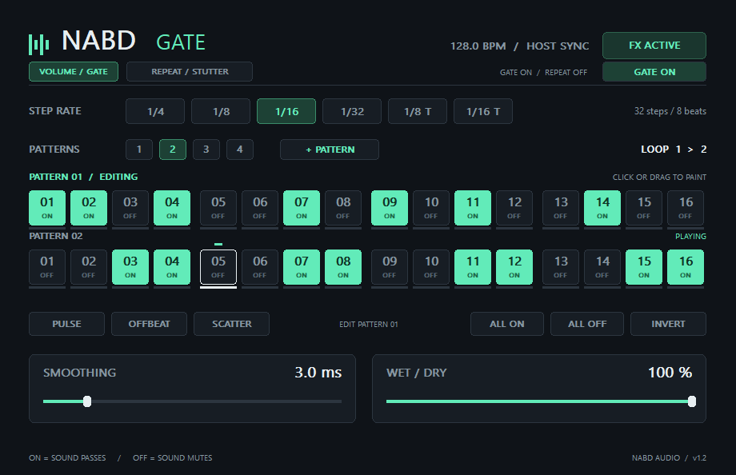
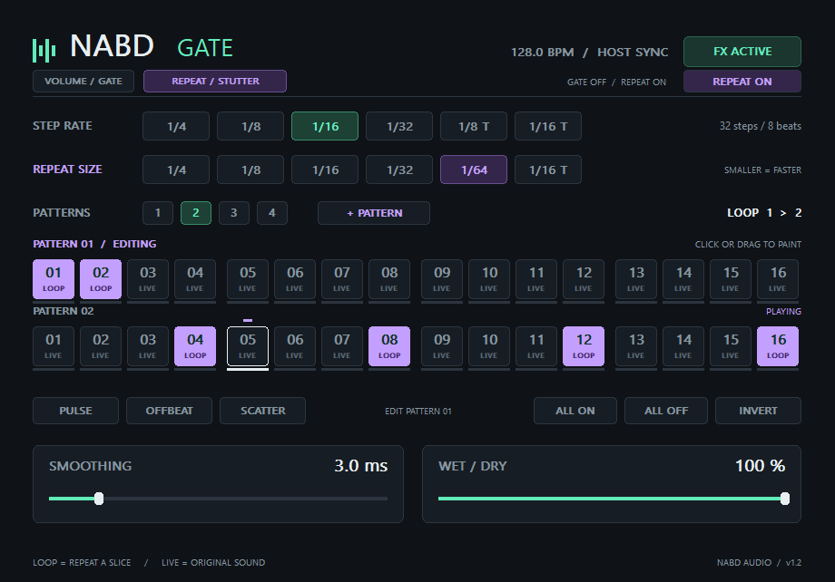

# Nabd Gate — نبض

بلجن التقطيع الإيقاعي الخاص بك، لويندوز 64 بت بصيغة VST3.

**تحديث 1.2:** أضفنا تبويب Repeat / Stutter بنمط مستقل لتكرار الصوت، مع الاحتفاظ بصفوف الـGate الأربعة. النسخة الجديدة تبدأ بصفين، والتكرار يكون مقفولًا لحد ما تفعّله.

## تجربة التكرار بسرعة

1. افتح تبويب **Volume / Gate** واضغط **Gate On** ليبقى **Gate Off** لو عايز تسمع التكرار لوحده.
2. افتح تبويب **Repeat / Stutter** واضغط **Repeat Off** ليبقى **Repeat On**.
3. اختار **Step Rate = 1/16** و**Repeat Size = 1/32** أو **1/64**.
4. لوّن المربعات اللي عايز التكرار يشتغل فيها وشغّل المشروع. **LOOP البنفسجي** يكرر جزءًا من الصوت، و**LIVE المطفي** يمرّر الصوت الطبيعي.

كل مربع LOOP يلتقط جزءًا من الصوت الداخل قبل بدايته ويكرره بطوله الأصلي. حجم أصغر يعمل تكرار أسرع، من غير تغيير طبقة الصوت. المربعات المتجاورة تعيد التقاط صوت حديث عند كل خطوة. في بداية التشغيل، الصوت يفضل طبيعيًا لحد ما تتسجل قطعة كاملة بالحجم المختار.

حجم التكرار متزامن مع التيمبو: **1/4، 1/8، 1/16، 1/32، 1/64، 1/16 T**. لكل من Gate وRepeat رسم مستقل من 4 صفوف؛ عدد الصفوف وسرعة الخطوات مشتركان لتشغيل القسمين معًا في نفس التوقيت. التبويب يغيّر القسم اللي بتعدله؛ زر On/Off داخل كل قسم يحدد إذا كان مسموعًا.

يمكن تشغيل **Gate وRepeat معًا**؛ وقتها التكرار يتطبّق على الصوت ثم نمط الـGate يفتح ويكتم الناتج. Wet/Dry وSmoothing مشتركان، وزر FX Active / Bypassed يتجاوز الإفكت كله. إيقاف التشغيل أو الانتقال لمكان آخر يمسح التسجيل المؤقت حتى لا يرجع صوت قديم.

## التركيب في FL Studio

**التثبيت التلقائي:** افتح `Nabd-Gate-Setup.exe` ووافق على طلب صلاحية ويندوز لو ظهر. المُثبّت ينسخ البلجن كاملًا إلى فولدر VST3 تلقائيًا ويتحقق من سلامة الملفات. بعدها افتح **Manage plugins → Find installed plugins** في FL Studio. لا تحتاج نسخ الملفات يدويًا مع المُثبّت.

**التركيب اليدوي كبديل:**

1. فك ضغط الملف أولاً.
2. انسخ **فولدر `Nabd Gate.vst3` بالكامل** إلى:

   `C:\Program Files\Common Files\VST3\`

   لو فولدر VST3 مش موجود، اعمله. ويندوز ممكن يطلب صلاحية مسؤول عند النسخ. احتفظ بفولدر Contents والملفات اللي داخله زي ما هي.
3. في FL Studio افتح **Options → Manage plugins**. لو مش ظاهر مباشرةً، افتح **Options → File settings → Manage plugins**.
4. فعّل **Verify plugins** واضغط **Find installed plugins**. البلجن هيظهر باسم **Nabd Gate** ضمن Effects.
5. اربط الصوت بقناة Mixer، وأضف Nabd Gate في FX slot على نفس القناة.
6. شغّل المشروع بـ Play. البلجن بياخد التيمبو ومكان التشغيل تلقائيًا من FL Studio.

مرجع خطوات التركيب: [دليل FL Studio الرسمي](https://www.image-line.com/fl-studio-learning/fl-studio-online-manual/html/basics_externalplugins.htm).

## الاستخدام

- **المربع الأخضر ON:** الصوت يعدّي.
- **المربع المطفي OFF:** الصوت يتكتم عند وصول المؤشر له.
- تقدر تدوس على المربع لتغييره، أو تسحب بالماوس على عدة مربعات لرسم النمط.
- **+ Pattern:** يضيف صف باترن جديد، لحد 4 صفوف. أزرار **Patterns 1 / 2 / 3 / 4** تختار عدد الصفوف اللي تدخل في التسلسل.
- التشغيل يكمل الصف الأول، ثم الثاني، ثم الثالث والرابع لو مفعّلين، وبعد آخر صف يرجع للأول. السهم **Loop 1 > 2** يوضح ترتيب الدورة.
- كل صف له 16 خطوة مستقلة. دوس على عنوان الصف أو أي مربع فيه لتحديده للتحرير؛ كلمة **Editing** توضّح الصف المختار، وكلمة **Playing** توضّح اللي شغال حاليًا.
- أزرار الأنماط الجاهزة وAll On / All Off / Invert تؤثر على الصف المختار فقط.
- **Step Rate:** مدة كل خطوة: 1/4 أو 1/8 أو 1/16 أو 1/32، وكمان 1/8 T و1/16 T للتريبلت.
- عند سرعة **1/16**، الـ16 مربع يعملوا دورة من 4 نبضات؛ مازورة واحدة لو المشروع 4/4.
- مع صفين عند **1/16**، الدورة تبقى 8 نبضات؛ مازورتين في 4/4. مع 4 صفوف تبقى 4 موازير. تقليل عدد الصفوف يحتفظ بالمربعات المخفية لو أضفت الصفوف مرة تانية.
- **Smoothing:** نعومة الفتح والقفل من 0 إلى 20 مللي ثانية. ابدأ بـ3 ms. الصفر يعطي تقطيعًا حادًا وممكن يسبب طقطقة عند قطع الموجة.
- **Wet / Dry:** عند 100% تسمع التقطيع بالكامل. عند 0% تسمع الصوت الأصلي؛ زوّدها لـ100% لو عايز المربعات OFF تكتم تمامًا.
- **FX Active / Bypassed:** زر لتفعيل الإفكت كله أو تمرير الصوت الأصلي.
- **Pulse / Offbeat / Scatter:** أنماط بداية جاهزة.
- **All On / All Off / Invert:** تشغيل كل الخطوات أو كتمها أو عكس النمط.
- النمط والتحكمات بيتحفظوا مع مشروع FL Studio. الخطوات والسرعة والنعومة وWet وBypass قابلة للأوتوميشن.
- إعدادات نسخة 1.0 تفتح بصف واحد، وإعدادات 1.1 تحتفظ بكل صفوفها، والتكرار يفضل مقفولًا. بعد حفظ المشروع بالنسخة الجديدة، استخدم 1.2 أو أحدث لفتحه. حجم التكرار، رسمه، ومفاتيح تشغيل القسمين بيتحفظوا وقابلين للأوتوميشن.

**لازم الترانسبورت يكون شغال** عشان النمط يمشي. لما المشروع واقف، الصوت يعدّي للمعاينة. ده إفكت بيعدّل الصوت الداخل له؛ حمّل الصوت أو الآلة في FL Studio ووجّهها لقناة الميكسر أولًا.

## الملفات

- `Nabd Gate.vst3`: البلجن الجاهز؛ انسخ الفولدر كله.
- `Nabd-Gate-Setup.exe`: مُثبّت تلقائي مستقل لويندوز 64 بت.
- `installer`: سورس المُثبّت وسكريبت بنائه.
- `source`: السورس C++ القابل للتعديل.
- `build.ps1` و`BUILDING.md`: إعادة البناء.
- `tests`: اختبارات تحميل البلجن والصوت والواجهة.
- `VALIDATION.md`: نتائج الاختبارات وحدودها.
- `licenses`: تراخيص المكتبات المضمّنة.

النسخة اتجمّعت واتحمّلت واتاختبرت في هوست اختبار وpluginval. **لم تُختبر داخل FL Studio نفسه**؛ أول تجربة عندك هتأكد التوافق مع إصدارك وإعداداته.
